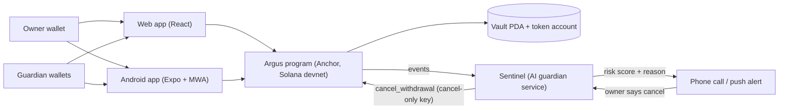

<p align="center">
  
</p>

<h1 align="center">Argus</h1>

<p align="center">
  
  
  
  
  
</p>
<p align="center">
  
  
  
  
  
  
</p>

<p align="center"><strong>Crypto has no undo. Argus gives it 24 hours.</strong></p>

<p align="center">
  A self-custodial savings vault on Solana.<br />
  Big withdrawals wait, an AI guardian watches every one, and a single word on a phone call stops a thief.
</p>

<p align="center">
  <a href="#try-it">Try it</a> ·
  <a href="#how-argus-works">How it works</a> ·
  <a href="#architecture">Architecture</a> ·
  <a href="#the-program">Program</a> ·
  <a href="#getting-started">Getting started</a> ·
  <a href="#security">Security</a>
</p>

## Try it

| | |
| --- | --- |
| **Program (devnet)** | [`4LH7ikNGVVNaemB7eaLGUMbwSBHHqA2hKXTdrfhgD6nh`](https://explorer.solana.com/address/4LH7ikNGVVNaemB7eaLGUMbwSBHHqA2hKXTdrfhgD6nh?cluster=devnet) |
| **Web app** | Run locally (see [Getting started](#getting-started)). The hosted link will be added here when it's deployed. |
| **"Steal my wallet" demo** | `/demo` in the web app. You get a fresh devnet vault holding 12,000 test dollars, plus its real owner key. Try to drain it: every move is a real transaction against the program, and Argus stops you live. It scores the request, then calls you as the owner: a real AI voice call (ElevenLabs), in the browser or on your own phone if you scan the QR code. Say "cancel", and it cancels and freezes on-chain with its cancel-only key. No wallet or sign-up needed. |
| **Android app** | [`mobile/`](mobile/). The APK link will be added here when the build is published. |

> **Devnet only.** Argus has not been audited by a third party. Use test tokens.

---

## Contents

- [Overview](#overview)
- [How Argus works](#how-argus-works)
- [Who can do what](#who-can-do-what)
- [Architecture](#architecture)
- [The program](#the-program)
- [Technology stack](#technology-stack)
- [Getting started](#getting-started)
- [Repository structure](#repository-structure)
- [Security](#security)
- [Documentation](#documentation)
- [Status](#status)

## Overview

On-chain, whoever holds the key owns the money. A stolen key means a single transaction, final in under a second, and there's no bank to call. Exchanges offer cancellable vaults, but only by holding your keys. Bitcoin vaults need a protocol change that hasn't happened.

Argus brings the safety of a bank hold to self-custody, enforced by a Solana program:

- **Everyday spending is instant**, within a daily allowance.
- **Sends to your own trusted addresses are instant**, at any amount.
- **Anything else waits**, 24 hours by default. You, any guardian or the AI guardian can cancel it during the wait.
- **If it looks like theft, Argus phones you.** Say "cancel", and it's cancelled on-chain by a key that can only cancel or freeze. It can never move funds.

## How Argus works

1. **Large withdrawals wait.** `request_withdrawal` creates a pending withdrawal with a public countdown. Nothing moves until it matures.
2. **An AI guardian watches each one.** Sentinel scores every request: the destination's age, lookalike (address-poisoning) checks, the share of the vault, the time of day, and public scam reports.
3. **It calls you.** On a high score Argus phones the owner. "Cancel" makes Sentinel sign `cancel_withdrawal` with the cancel-only AI key.
4. **Guardians recover.** The guardian threshold rotates the owner key. That bumps `owner_epoch`, which voids every withdrawal the old key requested.

## Who can do what

Every role is checked by the program on every instruction.

| Role | Can | Cannot |
| --- | --- | --- |
| **Owner** (main key) | Deposit, spend within the daily allowance, send to trusted addresses, request delayed withdrawals, cancel, freeze | Change any rule, key or trusted address, unfreeze, skip the delay |
| **Any one guardian** | Cancel, freeze, veto a pending change, sweep everything to the pre-set safe address | Send funds anywhere except the safe address, block their own removal |
| **Guardian threshold** (1-of-1 to 3-of-5) | Rotate the owner, add or remove trusted addresses, change limits, the delay, the safe address, the guardians or the AI key, unfreeze | Shorten a withdrawal that's already pending |
| **AI guardian** (Sentinel) | Cancel a pending withdrawal, freeze | Move any funds, propose, approve or veto |

## Architecture



| Layer | Responsibility |
| --- | --- |
| **Program** | Holds the funds and enforces every rule: delays, allowance, roles, governance, epochs. It's the security boundary. |
| **Sentinel** | Node service. Watches pending withdrawals, scores risk from on-chain signals, alerts the owner, and signs cancel or freeze with a key that can do nothing else. It also runs the live demo. |
| **Web app** | Landing page, the vault app (home, send, activity, guardians, settings) and the live demo. |
| **Android app** | The same vault on Solana Mobile, with push alerts and one-tap cancel through Mobile Wallet Adapter. |

## The program

`programs/argus/` is an Anchor program with **14 instructions**:

| Area | Instructions |
| --- | --- |
| Setup and funds in | `initialize_vault`, `deposit` |
| Funds out | `withdraw_instant`, `withdraw_trusted`, `request_withdrawal`, `execute_withdrawal` |
| Protection | `cancel_withdrawal`, `freeze`, `emergency_sweep` |
| Governance | `propose`, `approve`, `veto`, `execute_proposal`, `close_proposal` |

**Accounts:** `Vault`, `Withdrawal`, `Proposal`, `TrustedAddress`, all PDAs. Governance actions:
- **Immediate:** `RotateOwner`, `Unfreeze`, `RemoveTrusted`, `TightenLimits`.
- **Wait the full delay and can be vetoed:** `AddTrusted`, `LoosenLimits`, `SetSafeAddress`, `SetGuardians`, `SetAiGuardian`.
- **Proposals expire** if they don't reach the threshold within 7 days.

**Key guarantees** (from [the spec](docs/PROGRAM-SPEC.md), each one tested):
- Funds leave only through four paths: the allowance, a trusted address, a matured withdrawal, or a sweep to the safe address.
- The owner key alone can't change any rule.
- Nothing shortens a pending delay.
- While frozen, only the sweep moves funds.
- The AI key can only cancel and freeze.
- Rotating the owner voids the old key's withdrawals.
- Changing guardians kills old proposals.

**Tests:** 148 LiteSVM tests cover every instruction, every invariant and every named attack in the [threat model](docs/THREAT-MODEL.md). They include a seeded property fuzz of 20 seeds × 300 random steps that checks the invariants after every step.

## Technology stack

| Area | Technology |
| --- | --- |
| On-chain | Rust 1.89, Anchor 1.2.2, SPL Token (classic), Solana devnet |
| Program tests | LiteSVM 0.15 (clock warping, no validator) |
| Web | React 19, TypeScript 7, Vite 8, Tailwind CSS 4, React Router 7 |
| Mobile | Expo SDK 58, React Native 0.88, Solana Mobile Wallet Adapter 3 |
| Sentinel | Node 24 (built-in HTTP and TypeScript), @coral-xyz/anchor, @solana/web3.js, Server-Sent Events, Postgres on Neon, Vercel Functions |
| Voice | ElevenLabs Agents (Argus Guardian agent, client tools `cancel_withdrawal` / `allow_withdrawal`), `@elevenlabs/client` |
| RPC | Helius (devnet) |

## Getting started

### Prerequisites

- Rust, the Solana CLI (Agave 4.4) and Anchor 1.2.2. On Windows, run these inside WSL.
- Node.js 24 and npm.

### Program

```bash
anchor build                 # builds programs/argus and the IDL
cargo test --no-fail-fast    # runs all 148 tests (LiteSVM, no validator needed)
node scripts/export-idl.mjs  # copies the IDL into app/src/idl/ (run on Windows)
```

### Web app

```bash
cd app
npm install
npm run dev      # http://localhost:5173
npm run build
```

The vault app currently runs on a clearly labelled sample vault. The wallet connection and live devnet data are in progress, see [Status](#status).

### Sentinel (AI guardian service)

```bash
cd sentinel
npm install
npm run setup:keys   # creates its keypairs in sentinel/keys/ (gitignored); prints public keys only
cp .env.example .env # then set RPC_URL, DATABASE_URL (Postgres, e.g. Neon) and ALLOWED_ORIGINS
# fund the "funder" and "ai-guardian" public keys with devnet SOL
npm run dev          # http://localhost:8787/v1/health
node --env-file=.env src/smoke.ts   # end-to-end demo check against devnet
```

Demo state lives in Postgres, not in memory, so the same code runs as a long-lived server or as a **Vercel function**. `vercel.json` builds it with `npm run build:vercel` (one bundled function, Build Output API). On Vercel, set the keys as environment variables (`KEY_FUNDER`, `KEY_AI_GUARDIAN`, `KEY_DEMO_GUARDIAN`, `KEY_DEMO_SAFE`, each the key file's JSON array) along with `DATABASE_URL`, `RPC_URL`, `ALLOWED_ORIGINS` and `TRUST_PROXY_HOPS=1`. See [`sentinel/.env.example`](sentinel/.env.example).

The web app finds Sentinel through `VITE_SENTINEL_URL` (default `http://localhost:8787`). See [`app/.env.example`](app/.env.example).

### Android app

See [`mobile/README.md`](mobile/README.md).

## Repository structure

Build output, dependencies, keys and `.env` files are gitignored. Font files and raw audit-run artifacts are omitted below. Regenerate this tree with `python scripts/readme-tree.py`.

```
argus/
├── app/                               # web app (React + Vite + Tailwind)
│   ├── public/
│   │   ├── img/
│   │   │   ├── hero-dawn-640.webp
│   │   │   └── hero-dawn.webp
│   │   └── favicon.svg
│   ├── src/
│   │   ├── app/                       # vault app: shell, store, pages
│   │   │   ├── pages/
│   │   │   │   ├── Activity.tsx
│   │   │   │   ├── Guardians.tsx
│   │   │   │   ├── Overview.tsx
│   │   │   │   ├── Rules.tsx
│   │   │   │   └── Send.tsx
│   │   │   ├── AppRoot.tsx
│   │   │   ├── parts.tsx
│   │   │   ├── Shell.tsx
│   │   │   └── store.tsx
│   │   ├── components/
│   │   │   ├── Icon.tsx
│   │   │   ├── Logo.tsx
│   │   │   └── ui.tsx
│   │   ├── demo/                      # "steal my wallet" live demo
│   │   │   ├── DemoPage.tsx
│   │   │   ├── IncomingCall.tsx
│   │   │   ├── PhonePage.tsx
│   │   │   └── QrCode.tsx
│   │   ├── idl/                       # program IDL + TS types (scripts/export-idl.mjs)
│   │   │   ├── argus.json
│   │   │   └── argus.ts
│   │   ├── landing/                   # landing page and product replay
│   │   │   ├── Landing.tsx
│   │   │   └── ProductShot.tsx
│   │   ├── lib/                       # config, formatting, hooks, Sentinel client
│   │   │   ├── config.ts
│   │   │   ├── format.ts
│   │   │   ├── hooks.ts
│   │   │   └── sentinel.ts
│   │   ├── index.css
│   │   └── main.tsx
│   ├── .env.example
│   ├── .oxlintrc.json
│   ├── index.html
│   ├── package.json
│   ├── tsconfig.app.json
│   ├── tsconfig.json
│   ├── tsconfig.node.json
│   ├── vercel.json
│   └── vite.config.ts
├── docs/                              # spec, threat model, audits, design, API contract
│   ├── assets/
│   │   └── argus.svg
│   ├── audits/                        # internal audit rounds + devnet verification
│   │   ├── claude-r1.md
│   │   ├── codex-devnet-2026-11-27.md
│   │   ├── codex-r1-manifest-final.json
│   │   ├── codex-r1-manifest.json
│   │   ├── codex-r1-reconciliation.md
│   │   ├── codex-r1.md
│   │   └── codex-sentinel-2026-11-27.md
│   ├── AUDIT-CHECKLIST.md
│   ├── CONTEXT.md
│   ├── DEMO-SCRIPT.md
│   ├── DESIGN.md
│   ├── HANDOFF.md
│   ├── MOBILE.md
│   ├── PROGRAM-SPEC.md
│   ├── SENTINEL-API.md
│   └── THREAT-MODEL.md
├── mobile/                            # Android app (Expo + Mobile Wallet Adapter)
│   ├── assets/
│   │   ├── adaptive-icon.png
│   │   ├── hero-dawn.webp
│   │   ├── icon.png
│   │   ├── icon.svg
│   │   └── notification-icon.png
│   ├── scripts/
│   │   ├── brand-assets.mjs
│   │   └── smoke-sentinel.ts
│   ├── src/
│   │   ├── components/
│   │   │   ├── DawnHero.tsx
│   │   │   ├── GuardianCall.tsx
│   │   │   ├── Intro.tsx
│   │   │   ├── NativeVoice.tsx
│   │   │   ├── SignalIcon.tsx
│   │   │   ├── TransactionNotice.tsx
│   │   │   ├── ui.tsx
│   │   │   └── VaultPatterns.tsx
│   │   ├── domain/
│   │   │   ├── demo.test.ts
│   │   │   ├── demo.ts
│   │   │   ├── guardianCall.test.ts
│   │   │   ├── guardianCall.ts
│   │   │   ├── vaultMetrics.test.ts
│   │   │   └── vaultMetrics.ts
│   │   ├── idl/
│   │   │   ├── argus.json
│   │   │   ├── argus.ts
│   │   │   └── README.md
│   │   ├── program/
│   │   │   ├── bundle-check.ts
│   │   │   ├── client.test.ts
│   │   │   ├── client.ts
│   │   │   ├── errors.test.ts
│   │   │   ├── errors.ts
│   │   │   ├── node-files-unavailable.ts
│   │   │   ├── read.ts
│   │   │   ├── runtime.ts
│   │   │   ├── transactions.test.ts
│   │   │   └── transactions.ts
│   │   ├── screens/
│   │   │   ├── Alert.tsx
│   │   │   ├── Alerts.tsx
│   │   │   ├── Connect.tsx
│   │   │   ├── Guardians.tsx
│   │   │   ├── LiveApp.tsx
│   │   │   ├── LiveDemo.tsx
│   │   │   ├── Pending.tsx
│   │   │   ├── SentinelVault.tsx
│   │   │   ├── Settings.tsx
│   │   │   └── Vault.tsx
│   │   ├── sentinel/
│   │   │   ├── client.ts
│   │   │   ├── demo.test.ts
│   │   │   ├── demo.ts
│   │   │   ├── demoRuntime.ts
│   │   │   ├── mock.ts
│   │   │   ├── rules.ts
│   │   │   ├── runtime.ts
│   │   │   ├── sentinel.test.ts
│   │   │   ├── types.ts
│   │   │   └── useResource.ts
│   │   ├── services/
│   │   │   ├── demoEvents.ts
│   │   │   ├── notifications.ts
│   │   │   ├── voice.ts
│   │   │   └── wallet.ts
│   │   ├── polyfills.ts
│   │   └── theme.ts
│   ├── .env.example
│   ├── app.config.ts
│   ├── app.json
│   ├── App.tsx
│   ├── eas.json
│   ├── index.ts
│   ├── metro.config.cjs
│   ├── package.json
│   ├── README.md
│   └── tsconfig.json
├── programs/
│   └── argus/                         # Anchor program
│       ├── src/                       # instructions, state, governance, errors, events
│       │   ├── instructions/
│       │   │   ├── approve.rs
│       │   │   ├── cancel_withdrawal.rs
│       │   │   ├── close_proposal.rs
│       │   │   ├── deposit.rs
│       │   │   ├── emergency_sweep.rs
│       │   │   ├── execute_proposal.rs
│       │   │   ├── execute_withdrawal.rs
│       │   │   ├── freeze.rs
│       │   │   ├── initialize_vault.rs
│       │   │   ├── propose.rs
│       │   │   ├── request_withdrawal.rs
│       │   │   ├── shared.rs
│       │   │   ├── veto.rs
│       │   │   ├── withdraw_instant.rs
│       │   │   └── withdraw_trusted.rs
│       │   ├── constants.rs
│       │   ├── error.rs
│       │   ├── events.rs
│       │   ├── governance.rs
│       │   ├── instructions.rs
│       │   ├── lib.rs
│       │   └── state.rs
│       ├── tests/                     # 148 LiteSVM tests (attack, rollback, fuzz)
│       │   ├── common/
│       │   │   └── mod.rs
│       │   ├── deposit.rs
│       │   ├── fuzz.rs
│       │   ├── governance.rs
│       │   ├── initialize_vault.rs
│       │   ├── protective.rs
│       │   ├── rollback.rs
│       │   ├── withdraw_instant.rs
│       │   ├── withdraw_trusted.rs
│       │   └── withdrawals.rs
│       └── Cargo.toml
├── scripts/                           # IDL export, README tree
│   ├── export-idl.mjs
│   └── readme-tree.py
├── sentinel/                          # AI guardian service: demo, watcher, call, cancel/freeze
│   ├── scripts/
│   │   └── build-vercel.mjs
│   ├── src/
│   │   ├── chain.ts
│   │   ├── db.ts
│   │   ├── demo.ts
│   │   ├── handler.ts
│   │   ├── keys.ts
│   │   ├── server.ts
│   │   ├── setup-keys.ts
│   │   ├── smoke.ts
│   │   └── vercel.ts
│   ├── .env.example
│   ├── demo-config.json
│   ├── package.json
│   ├── tsconfig.json
│   └── vercel.json
├── AGENTS.md
├── Anchor.toml
├── Cargo.lock
├── Cargo.toml
├── CLAUDE.md
├── PLAN.md
├── README.md
├── rust-toolchain.toml
└── security.json
```

## Security

- **Devnet only, no third-party audit.** Two independent internal audit rounds: [Claude](docs/audits/claude-r1.md), [Codex](docs/audits/codex-r1.md), and the [reconciliation](docs/audits/codex-r1-reconciliation.md).
- **Verified deploy.** The deployed bytecode matches the tested build (SHA-256 `831417e4…72f9`), recorded in [HANDOFF](docs/HANDOFF.md).
- **Upgrade authority.** For the hackathon, a single developer wallet can upgrade the program. Before real funds it should move to a multisig or the program should be made immutable.
- **Known limit.** If a thief holds both the owner key and enough guardian keys to meet the threshold, they can eventually take the funds. Keep keys on separate devices and with separate people.
- **Argus never asks for your seed phrase.** A call only ever offers one action: say "cancel".

## Documentation

| Document | What it covers |
| --- | --- |
| [PROGRAM-SPEC](docs/PROGRAM-SPEC.md) | On-chain behaviour, the source of truth |
| [THREAT-MODEL](docs/THREAT-MODEL.md) | Every attack considered and its defence |
| [AUDIT-CHECKLIST](docs/AUDIT-CHECKLIST.md) | What each audit round verifies |
| [SENTINEL-API](docs/SENTINEL-API.md) | The AI guardian service contract |
| [DESIGN](docs/DESIGN.md) | Visual direction for web and mobile |

## Status

| Part | State |
| --- | --- |
| Program | ✅ Deployed to devnet, 148 tests passing, audit round 1 done |
| Web: landing page and vault app | ✅ Built (sample vault) |
| Web: "steal my wallet" live demo | ✅ Live on devnet (Sentinel cancels and freezes on-chain) |
| Sentinel: demo, watcher, cancel and freeze | ✅ Built for Vercel and Neon; tested locally (smoke, race and timeout checks) |
| Voice call: live in-browser call with the Argus agent (ElevenLabs) | ✅ Built: the agent cancels on "no, cancel it" |
| The owner's real phone rings: scan a QR on `/demo`, take the live ElevenLabs call on your phone, and the laptop follows along | ✅ Built (no phone number or Twilio needed) |
| Hosting: web and Sentinel on Vercel | ⏳ Deploying |
| Sentinel: scam lookups | ⏳ Next |
| Web: wallet connection and live devnet data | ⏳ Next |
| Android app | 🔨 In progress |
